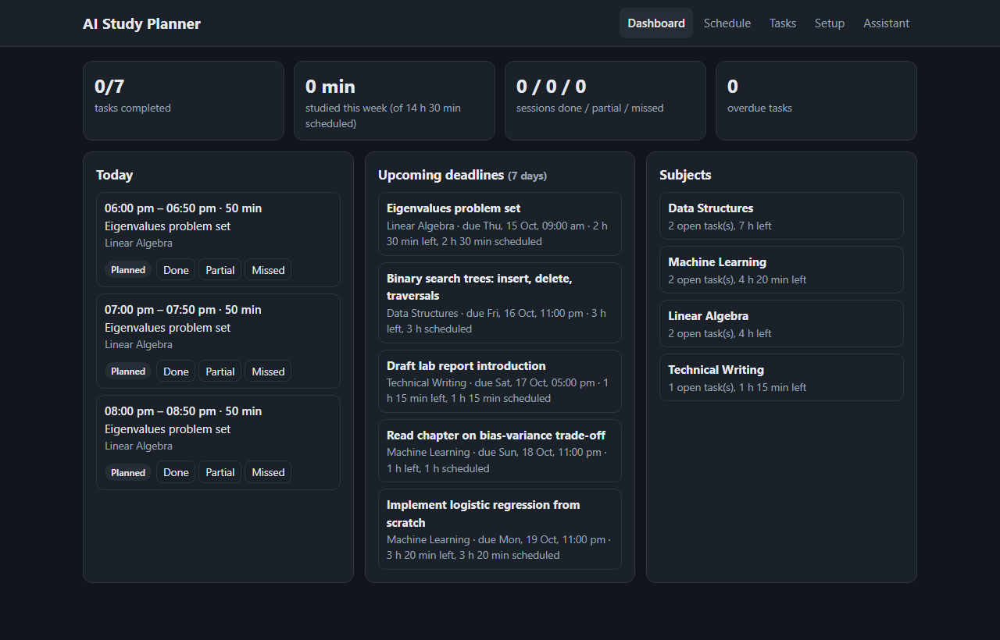
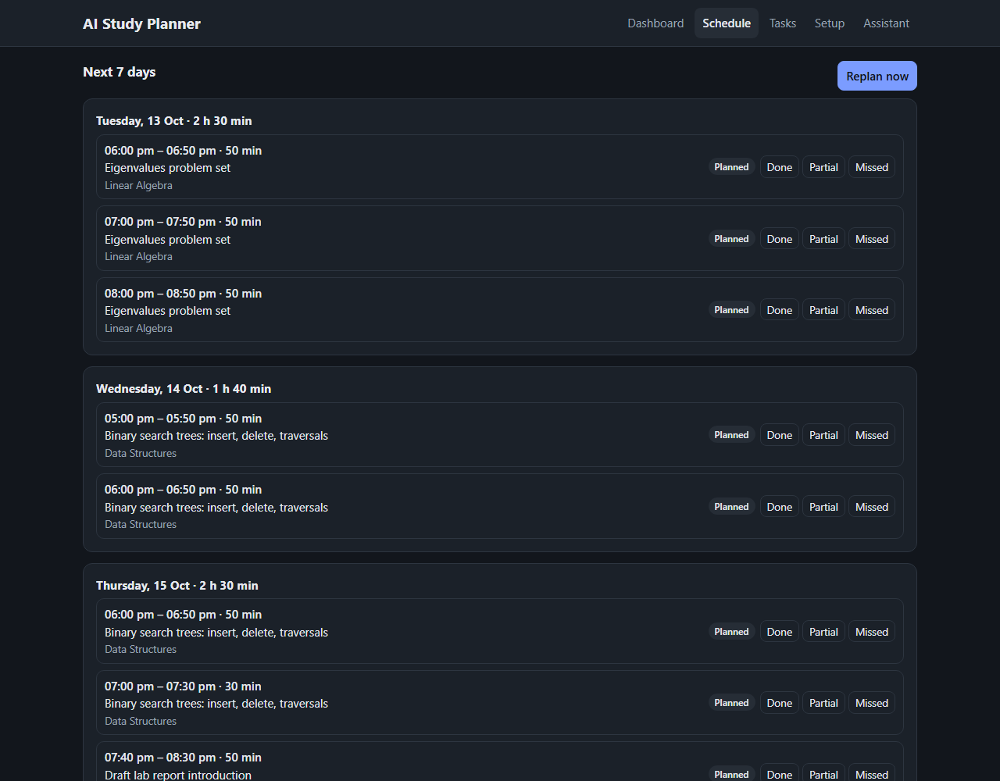
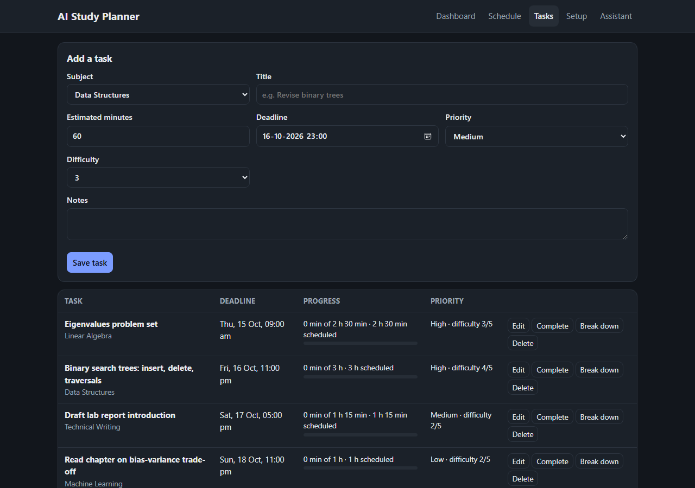
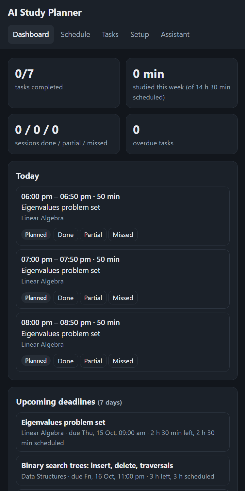
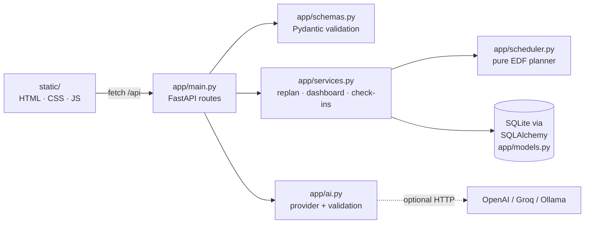

# AI Study Planner

[](https://github.com/iwan-adler/ai-study-planner/actions/workflows/tests.yml)

A study planner that turns your tasks, deadlines and weekly availability into a realistic day-by-day schedule. When sessions are completed, partially completed or missed, it replans the rest of your week, and it tells you honestly when something can't fit before its deadline.

The core scheduler is **deterministic and rule-based**. AI is an **optional** extra that explains the plan and suggests task breakdowns. Its output is validated against your real data, and it is never saved without your action. The app works fully without any AI configured.



## Why

Students usually know *what* is due but not *when* to work on it. Static timetables break the first time you miss a session, and "AI planners" often produce schedules that ignore your real free time or double-book you. This app treats scheduling as a constraint problem:
- Sessions only go where you said you're available.
- They never overlap.
- They respect your session length, breaks and daily limit.
- Anything that doesn't fit is reported instead of hidden.

## Features

Everything in this section is implemented and covered by automated tests.

**Setup**
- **Profile:** name, goals, maximum session length, break length and daily study limit.
- **Subjects:** add and delete; deleting is blocked while a subject still has tasks.
- **Weekly availability:** several windows per day, different on each day. Overlapping windows are rejected.

**Tasks**
- Create, edit, complete and delete tasks.
- Each task records subject, topic, notes, estimated minutes, priority (low/medium/high), difficulty (1–5) and deadline.
- Validation:
  - estimates from 15 minutes to 100 hours
  - deadlines must be in the future
  - priority and difficulty must be within range
  - the subject must exist
- Task progress: studied, scheduled and remaining minutes, plus an overdue flag.

**Scheduling**
- A daily and weekly schedule over a configurable horizon (7 days by default).
- Sessions are placed only inside availability, never overlap, and respect the maximum session length, breaks and daily limit.
- Long tasks are split into sessions automatically, without leaving pointless leftovers under 15 minutes.
- Honest reporting:
  - **unscheduled:** "Not enough available study time before the deadline: 800 of 900 min could not be placed."
  - **overdue:** tasks whose deadline has already passed.
  - **deferred:** work due after the horizon, which is planned in later runs.
- Every task gets an explanation of its ranking, e.g. "Ranked #1: deadline Thu 15 Oct 09:00, high priority…".

**Adaptive replanning**
- Mark a session **completed**, **partial** (with the minutes you actually studied) or **missed**.
- The future plan is rebuilt automatically after any change to tasks, availability or preferences, and after any check-in.
- Completed, partial and missed sessions are kept. Replanning only replaces future *planned* sessions, so it never creates duplicates.
- A missed slot stays blocked, so the work moves elsewhere instead of back into a time you couldn't make.
- A session that is in progress is kept.
- Past sessions you never marked appear under **"Did these happen?"**, and their time is not counted as studied.
- A task is completed automatically once all its estimated time has been studied.

**Dashboard**
- Today's sessions with check-in buttons.
- Upcoming deadlines (7 days) and overdue tasks.
- Task completion.
- Studied vs. scheduled minutes this week, and counts of done, partial and missed sessions.
- **Subjects needing attention:** overdue work, work that can't fit, or 2 or more missed sessions in the last 7 days.

**AI assistance (optional)**
- **Explain my plan:** a summary, notes per task and up to 5 revision tips.
- **Break down a task:** 2–8 proposed subtasks, checked against the free time left before the deadline.
- **Without an AI provider,** both features use rule-based logic, and the response is labelled `"rule-based"`.
- Details on how AI output is checked are in [How AI is kept honest](#how-ai-is-kept-honest).

**Interface**
- A single page in plain HTML, CSS and JavaScript, with no build step.
- Responsive down to phone width, keyboard-accessible, and with light and dark themes.
- All user text is rendered as text, never as HTML, so it can't run scripts. Tested with an `` title.

| Week view | Task management | Narrow screen |
|---|---|---|
|  |  |  |

*Screenshots show the bundled sample data (`python -m app.seed`) in dark mode.*

## How the scheduler works

The code is in [`app/scheduler.py`](app/scheduler.py): a pure function with no database, clock or AI, so it can be tested exactly.

1. **Free time.** Weekly availability windows are expanded into concrete intervals from *now* (rounded up to 5 minutes) to the end of the horizon. Busy time is removed: sessions in progress, completed, partial or missed.
2. **Ranking: Earliest Deadline First (EDF).** Open tasks are ordered by deadline. Ties go to the higher priority, then the higher difficulty.
3. **Greedy placement.** The scheduler walks through free intervals in time order. At each point it picks the highest-ranked task that still needs time and can finish a session before its deadline. The session length is the smallest of:
   - the maximum session length
   - the remaining work
   - the free interval
   - what's left of the daily limit
   - the time until the deadline

   A break follows each session. Lengths are adjusted so no task is left with a remainder under 15 minutes.
4. **Honest leftovers.** Work that can't be placed before its deadline is reported, never squeezed into an impossible timetable.

**Why EDF?** For one person doing one thing at a time, working in deadline order minimises the worst lateness. If *any* order can meet all your deadlines, deadline order can.

**Trade-offs**
- **Priority only breaks ties.** A high-priority task due Friday waits behind a low-priority task due Wednesday. That's deliberate: missing Wednesday's deadline would be worse.
- **Greedy, not optimal.** It front-loads urgent work and doesn't balance subjects across days or prefer certain times for hard topics. That keeps it simple, fast and explainable.
- **Replanning moves future sessions.** Each change can shift future planned sessions. Completed history never changes.

## How AI is kept honest

Implemented in [`app/ai.py`](app/ai.py):

| Rule | How |
|---|---|
| AI never invents stored data | AI endpoints are read-only. Applying a breakdown is a separate, explicit request (`POST /api/tasks/{id}/split`) that goes through normal validation |
| Output must match real data | Replies are parsed as JSON and validated. Notes about unknown task IDs are dropped with a warning. A breakdown's total must be within 25% of the task's remaining effort, with 2–8 subtasks of 15–240 minutes each, and it's checked against free time before the deadline |
| Malformed output can't break anything | Invalid JSON, wrong fields or provider errors fall back to the rule-based answer, with a warning naming the failed field |
| No pretending | Every response says `"source": "ai"` or `"rule-based"`, and the UI shows it |
| No silent cost | AI is off unless `AI_MODEL` is set, and works with free local models via Ollama |

**What was actually tested with real models,** using local Ollama on a laptop CPU:
- **Breakdown:** `hermes3:3b` returned a valid breakdown, which was accepted.
- **Rejected breakdowns:** `llama3.2` (3B) proposed subtasks totalling 270 minutes for a 180-minute task, which the validator rejected.
- **Explain:** both 3B models either timed out or returned JSON without the required `summary`, so the app fell back to the rule-based explanation, as designed.
- **Explain's success path** is therefore verified with test doubles, not with a real model. Larger models (8B+, or hosted APIs) are expected to do better but weren't tested.

## Architecture



| Module | Responsibility |
|---|---|
| `scheduler.py` | The algorithm. Pure functions with plain dataclasses in and out |
| `services.py` | Connects the database to the scheduler: replanning, check-ins, dashboard statistics |
| `models.py` / `database.py` | SQLAlchemy tables with `CHECK` constraints and foreign keys enforced |
| `schemas.py` | Every request and response shape, with validation rules |
| `ai.py` | `AIProvider` interface, OpenAI-compatible implementation, prompts, validation, rule-based fallbacks |
| `config.py` | Settings from environment variables or `.env` |
| `main.py` | Routes. `create_app()` factory, so tests get an isolated database, a fixed clock and fake AI |
| `seed.py` | Invented sample data for a quick demo |

**Design decisions**
- **A pure scheduler** makes the hardest logic the easiest to test. The suite includes a randomised test that checks every hard constraint on 300 generated weeks.
- **Replanning deletes only future *planned* sessions,** which makes it idempotent and protects history.
- **The clock is a dependency,** so tests can move time forward to check overdue tasks, missed sessions and in-progress sessions.
- **No module-level app object,** so importing the code never creates a database file. The server uses Uvicorn's `--factory` mode.
- **Times are local wall-clock time,** a deliberate simplification for a single-user local app (see Limitations).

## Setup

Requires Python 3.11 or newer; developed and tested on 3.14.

```bash
git clone https://github.com/iwan-adler/ai-study-planner.git
cd ai-study-planner
python -m venv .venv
```
```powershell
.venv\Scripts\Activate.ps1          # Windows PowerShell
```
```bash
source .venv/bin/activate           # macOS / Linux
```
```bash
pip install -r requirements.txt
python -m app.seed                  # optional: sample subjects, tasks and availability
uvicorn app.main:create_app --factory --reload
```

Open **http://127.0.0.1:8000**. API docs are at **/docs**.

Configuration is optional: copy [`.env.example`](.env.example) to `.env`. Settings include the database path, planning horizon and the optional AI provider (OpenAI, Groq, or Ollama with no key). `.env` and `*.db` files are gitignored.

## API

| Method | Path | Description |
|---|---|---|
| GET/PUT | `/api/profile` | Name, goals, session, break and daily limits |
| GET/PUT | `/api/availability` | Replace the weekly windows (`{"windows": [{"weekday": 0, "start_time": "18:00", "end_time": "21:00"}]}`) |
| GET/POST, DELETE | `/api/subjects`, `/api/subjects/{id}` | Subjects (`409` if one still has tasks) |
| GET/POST | `/api/tasks` | List or create tasks (create triggers a replan) |
| GET/PATCH/DELETE | `/api/tasks/{id}` | Read, edit (incl. `{"completed": true}`) or delete |
| GET | `/api/plan` | Sessions from today across the horizon, plus unscheduled, deferred and ranking reasons |
| POST | `/api/plan` | Replan now |
| PATCH | `/api/sessions/{id}` | Check in: `{"status": "completed"}`, `{"status": "partial", "actual_minutes": 20}`, `{"status": "missed"}` |
| GET | `/api/dashboard` | Everything the dashboard shows |
| GET | `/api/ai/status` | Whether an AI provider is configured |
| POST | `/api/ai/explain` | Plan explanation (AI or rule-based) |
| POST | `/api/ai/breakdown/{task_id}` | Subtask proposal; **nothing is saved** |
| POST | `/api/tasks/{id}/split` | Replace a not-yet-started task with subtasks |

```bash
curl -X POST http://127.0.0.1:8000/api/tasks -H "Content-Type: application/json" -d '{
  "subject_id": 1, "title": "Revise binary trees", "estimated_minutes": 120,
  "priority": 3, "difficulty": 4, "deadline": "2026-10-20T23:00"}'
```

Invalid input returns `422` with field-level messages. Conflicts return `409`, and missing records `404`.

## Run with Docker

```bash
docker compose up --build        # then open http://127.0.0.1:8000
```

How the image is set up:
- **Base:** `python:3.14-slim`, with runtime dependencies only (pytest stays out of the image).
- **Non-root user,** with the SQLite database on a named volume (`/data`), so data survives rebuilds and restarts.
- **Built-in `HEALTHCHECK`.**
- **Published on `127.0.0.1` only,** because the app has no login. Change the port mapping in `compose.yaml` only if you understand that exposes it to your network.

To load the sample data into the container's volume, run `docker compose run --rm app python -m app.seed`.

**How this is verified:** the CI `docker` job checks every push on a real Docker engine. It:
1. builds the image;
2. waits for the container to report **healthy**;
3. checks it runs as a **non-root** user;
4. creates data through the API;
5. restarts the container and confirms the **data is still there**.

Docker isn't installed on the development machine, so CI is where the image is tested.

## Tests

```bash
python -m pytest
```

There are 386 tests, which run in about 12 seconds with no network.

| File | Covers |
|---|---|
| `test_scheduler.py` | Availability, overlaps, breaks, daily limit (including time already studied), EDF and tie-breaks, deadlines, insufficient time, overdue and deferred work, no tiny remainders, determinism, **plus 300 randomised weeks checked against every hard constraint** |
| `test_api.py` | Validation of every input, subjects, task CRUD, replanning without duplicates, check-ins (completed, partial, missed), time passing, in-progress sessions, dashboard, splitting, persistence across restarts |
| `test_ai.py` | Rule-based fallbacks, validation of AI explanations and breakdowns, malformed replies, provider errors, request format, API key never in error messages |
| `test_seed.py` | Sample data loads once and produces a plan |

To check the tests themselves, I broke the replanning and missed-slot logic on purpose, and the suite caught both.

The browser UI has no automated tests. It was checked by hand against a running server:
- dashboard, schedule, task creation, a check-in, breakdown and split, the assistant
- an HTML title, to confirm it shows as text
- phone width, with no horizontal overflow

## Limitations

- **Single user and no authentication.** It's meant to run locally (Uvicorn listens on `127.0.0.1` by default).
- **Local wall-clock time.** There's no timezone support, and daylight-saving changes aren't handled. Availability windows can't cross midnight.
- **Greedy EDF.** See the trade-offs above. It doesn't balance subjects across the week or match hard topics to your best hours.
- **No recurring tasks and no calendar import.** University timetables aren't subtracted automatically, so enter your availability around them.
- **Unmarked past sessions are not assumed done.** You need to check in for progress to count.
- **AI quality depends on the model.** Small local models often fail validation, in which case the rule-based fallback is shown. Explanation text is validated in structure, not in every claim it makes.

## Future improvements

1. A "preferred times" setting, such as hard subjects in the morning, plus balancing subjects across days.
2. Calendar import (`.ics`) to block lectures automatically.
3. Recurring tasks, such as weekly problem sets.
4. Spaced-repetition revision sessions after a topic is completed.
5. Automated browser tests (Playwright) for the UI.
6. Accounts and per-user data for a hosted version.
